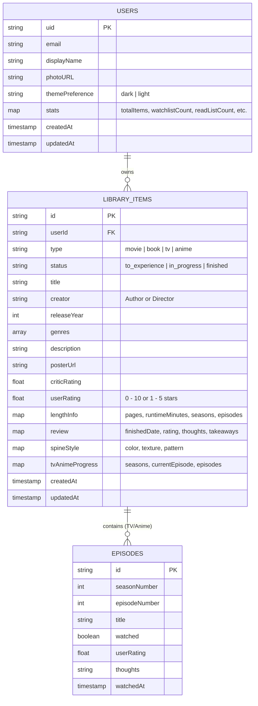

# Kalp Library — Firestore Database Architecture & Schema Specification

This document details the production Firestore schema, security rules, composite indexing, and extensibility models for Kalp Library.

---

## 1. High-Level Entity Relationship Model

---

## 2. Document Specifications

### `users/{userId}`
Stores user identity, authentication metadata, and personal preferences (e.g. Daylight vs Night Codex theme).

| Field | Type | Description |
| :--- | :--- | :--- |
| `uid` | `string` | Firebase Auth UID (document ID). |
| `email` | `string` | User's email address. |
| `displayName` | `string` | Display name or curator handle. |
| `photoURL` | `string \| null` | Avatar image URL. |
| `themePreference` | `string` | `"dark"` (Night) or `"light"` (Daylight). |
| `stats` | `map` | Aggregated counters (`totalItems`, `watchlistCount`, `readListCount`, `watchedCount`, `readCount`). |
| `createdAt` | `timestamp` | Account creation timestamp. |
| `updatedAt` | `timestamp` | Last profile or preference update. |

---

### `users/{userId}/library_items/{itemId}`
Stores all media entities curated by the user.

- **Watchlist**: Items where `type in ['movie', 'tv', 'anime']` and `status == 'to_experience'`.
- **ReadList**: Items where `type == 'book'` and `status == 'to_experience'`.
- **Completed Stack**: Items where `status == 'finished'` (marked watched or read), containing `review.thoughts` and `userRating`.

| Field | Type | Description |
| :--- | :--- | :--- |
| `id` | `string` | Unique Item ID. |
| `userId` | `string` | Owning user UID. |
| `type` | `string` | Enum: `'movie' \| 'book' \| 'tv' \| 'anime'`. |
| `status` | `string` | Enum: `'to_experience' \| 'in_progress' \| 'finished'`. |
| `title` | `string` | Title of the work. |
| `creator` | `string` | Author, Director, or Studio. |
| `releaseYear` | `number` | Year of publication or premiere. |
| `genres` | `array<string>` | Genre classification tags. |
| `posterUrl` | `string` | Cover image / movie poster URL. |
| `description` | `string` | Synopsis / overview. |
| `userRating` | `number \| null` | Rating assigned by user upon completion. |
| `review` | `map` | `finishedDate`, `thoughts` (personal journal/reflections), `takeaways`, `favoriteQuote`. |
| `spineStyle` | `map` | Appearance parameters for the continuous 3D wooden bookshelf (`color`, `texture`, `pattern`, `thicknessPx`). |
| `lengthInfo` | `map` | `{ pages?: number, runtimeMinutes?: number, seasons?: number, episodes?: number }`. |
| `tvAnimeProgress` | `map` | `{ totalSeasons, totalEpisodes, currentSeason, currentEpisode }`. |
| `createdAt` | `timestamp` | Date added to library. |
| `updatedAt` | `timestamp` | Last modified date. |

---

### `users/{userId}/library_items/{itemId}/episodes/{episodeId}` (Extensibility Subcollection)
Provides granular tracking for TV Series, Mini-series, and Anime.

| Field | Type | Description |
| :--- | :--- | :--- |
| `seasonNumber` | `number` | Season number (e.g. 1, 2). |
| `episodeNumber` | `number` | Episode number. |
| `title` | `string` | Episode title. |
| `watched` | `boolean` | Whether marked watched. |
| `userRating` | `number` | Episode-level rating. |
| `thoughts` | `string` | Notes/reactions on this specific episode. |
| `watchedAt` | `timestamp` | Date & time watched. |

---

## 3. Security Rules (`firestore.rules`)
- **Strict Authentication**: Only authenticated requests can read or write user collections.
- **User Isolation**: `request.auth.uid == userId` ensures no user can read or alter another user's personal journal, watchlist, or ratings.
- **Data Validation Constraints**:
  - `themePreference in ['dark', 'light']`
  - `type in ['movie', 'book', 'tv', 'anime']`
  - `status in ['to_experience', 'in_progress', 'finished']`
  - `userRating >= 0 && userRating <= 10`

---

## 4. Composite Indexes (`firestore.indexes.json`)
The following composite indexes have been provisioned in the live Firebase project:
1. `type` (ASC) + `status` (ASC) + `updatedAt` (DESC)
2. `status` (ASC) + `updatedAt` (DESC)
3. `type` (ASC) + `status` (ASC) + `userRating` (DESC)
4. `status` (ASC) + `userRating` (DESC)

